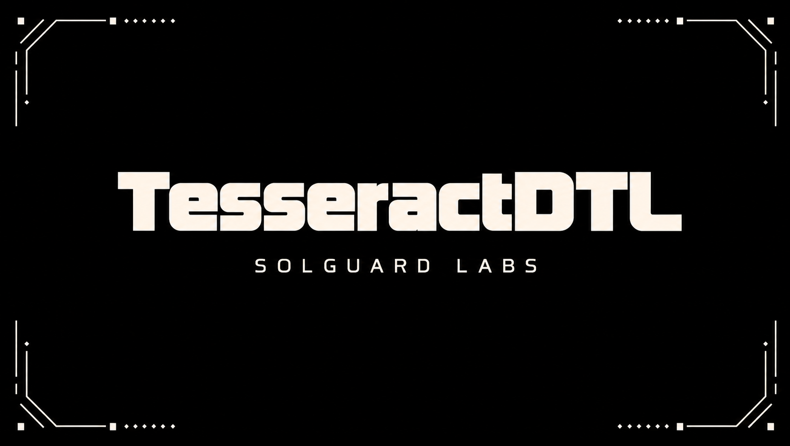

# TesseractDTL



TesseractDTL es un simulador C++ de liquidacion DTL entre dominios. Modela
ordenes que depositan obligaciones economicas en bovedas origen y que despues
se ejecutan mediante rutas multidimensionales compuestas por asset, dominio,
operador, ventana de liquidez y epoch.

El repositorio esta pensado para revision de auditoria local. El binario no
requiere servicios externos y los tests TypeScript ejecutan escenarios
deterministas contra la salida JSON de la CLI.

## Componentes

- `src/registry.*`: assets, dominios, operadores, ventanas y bovedas.
- `src/ledger.*`: balances, bovedas, obligaciones, pagos y surplus.
- `src/route.*`: ordenes, legs de ruta, route book y validaciones.
- `src/reducer.*`: reduccion de legs por dimensiones operativas.
- `src/settlement.*`: ejecucion por epoch e instrucciones reducidas.
- `src/reconcile.*`: agregados finales por asset, dominio y operador.
- `src/scenario.*`: escenarios deterministas para pruebas de contrato.
- `src/report.*`: serializacion JSON estable para integraciones.

## Requisitos

- Node.js 22 o superior.
- Un compilador C++17 disponible como `c++`, `g++`, `clang++` o MSVC.

En Windows, el build script tambien intenta localizar `vcvars64.bat` de Visual
Studio para compilar con `cl` aunque el compilador no este en `PATH`.

## Uso

Compilar:

```bash
node scripts/build.mjs
```

Listar escenarios:

```bash
out/tesseractdtl list
out/tesseractdtl list --json
```

Validar un escenario:

```bash
out/tesseractdtl validate balanced
```

Ejecutar un settlement completo:

```bash
out/tesseractdtl run balanced --json
```

Ejecutar hasta un epoch concreto:

```bash
out/tesseractdtl run multi-epoch --json --epoch 1
```

Incluir eventos de auditoria:

```bash
out/tesseractdtl run mesh-reconcile --json --events
```

## Tests

```bash
npm test
```

El comando compila el binario y ejecuta:

```bash
node --experimental-strip-types --test "tests/node/*.test.ts"
```

La suite publica cubre:

- contrato de CLI y salida JSON;
- depositos y creacion de rutas;
- settlement por epoch;
- controles de operadores y ventanas;
- reconciliacion final por asset, dominio y operador;
- rango de lineas de `src/` solicitado para el lab.

## Escenarios

- `balanced`: dos ordenes ZUSD desde Alpha hacia Beta en un epoch.
- `multi-epoch`: liquidacion gradual en tres epochs.
- `operator-windows`: operadores distintos y activos ZUSD/ZBTC.
- `mesh-reconcile`: malla de tres dominios con reconciliacion final.

## Flujo De CI

GitHub Actions ejecuta:

```bash
bash scripts/ci.sh
```

Ese script compila con warnings estrictos cuando el compilador lo permite y
ejecuta los tests TypeScript.

## Estado Del Lab

El proyecto es autocontenido y esta preparado para auditoria de logica de
settlement. La salida JSON de la CLI es el contrato principal para tests,
herramientas externas y comparacion de regresiones.
