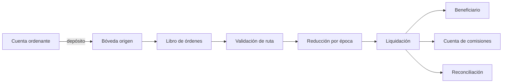

# TesseractDTL


Motor de liquidación multidominio en C++17. Registra órdenes, depósitos, rutas y ventanas; reduce rutas a instrucciones por época y emite un estado contable JSON. Se ejecuta localmente y no conecta con redes ni custodios externos.

## Modelo operativo



Cada orden conserva activo, dominio, bóveda, beneficiario e importe. Cada tramo añade dominio destino, operador, ventana y época. El registro comprueba las identidades y compatibilidad de dominios y bóvedas. La ejecución produce recibos y agregados contables por activo, bóveda y operador.

## Magnitudes económicas

Los importes son enteros en la unidad mínima del activo. Para bruto `G` y tarifa `f` en puntos básicos: `comisión = floor(G × f / 10 000)` y `neto = G − comisión`. La vista de tesorería calcula `cobertura = floor(caja × 10 000 / obligación pendiente)` cuando existe pasivo y `participación = floor(pagos de bóveda × 10 000 / pagos del activo)`. Cuando el denominador es cero, el indicador devuelve cero como valor no aplicable. Consulte [el modelo económico](docs/modelo-economico.md) para un ejemplo completo.

## Uso

Requiere Node.js 22+ y un compilador C++17 (`c++`, `g++`, `clang++` o MSVC). En Windows el script detecta instalaciones de Visual Studio.

```bash
npm ci
npm run build
./out/tesseractdtl list --json
./out/tesseractdtl validate balanced
./out/tesseractdtl run multi-epoch --json --epoch 1
./out/tesseractdtl treasury balanced
```

En Windows, use `out/tesseractdtl.exe`. `--epoch N` limita la liquidación hasta la época `N`. `--events` incorpora el registro de eventos en `run --json`. Los conjuntos reproducibles son `balanced`, `multi-epoch`, `operator-windows` y `mesh-reconcile`.

## Verificación y publicación

```bash
npm test
npm run ci
```

La suite TypeScript ejecuta el binario real y verifica CLI, depósitos, ventanas, liquidación parcial, reconciliación y tesorería. CI compila con avisos estrictos. `main`, `production` y el tag `v1.0.0` se verifican contra el mismo commit; el release no implica despliegue a una red.

## Documentación

- [Arquitectura y estados](docs/arquitectura.md)
- [Modelo económico y cálculos](docs/modelo-economico.md)
- [Operación y diagnóstico](docs/operacion.md)
- [Controles de seguridad](docs/controles-seguridad.md)
- [Política de seguridad](SECURITY.md)

El código principal está en `src/registry.*`, `src/ledger.*`, `src/route.*`, `src/reducer.*`, `src/settlement.*`, `src/reconcile.*` y `src/treasury.*`. `src/report.*` serializa el contrato JSON.
