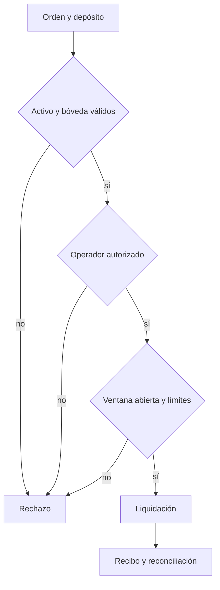

# Política de seguridad de TesseractDTL

## Superficies protegidas

El motor separa registro, admisión de órdenes, validación de rutas, ejecución y reconciliación. Los controles comprueban activos, dominios, ventanas, operadores y bóvedas antes de ejecutar una ruta. Una reconciliación agregada correcta no sustituye la revisión de cada transición.

## Invariantes operativas

- Cada orden declara activo registrado, importe positivo, época y bóveda del dominio de origen.
- Cada tramo conserva orden, activo, dominios, operador, ventana, importe y tarifa.
- El operador debe estar activo y habilitado para ambos dominios; la ventana debe contener la época.
- El importe liquidado no puede superar la obligación abierta de la orden.
- Pagos netos y comisiones suman el bruto ejecutado.
- Un mismo motor no debe liquidar dos veces una época.
- La vista de tesorería es de solo lectura y no autoriza pagos.

## Gestión de cambios

Cada propuesta debe superar compilación C++17, pruebas de integración y revisión de las invariantes afectadas. `main`, `production`, tag y publicación son estados independientes. No se incluyen secretos ni claves en el repositorio.

## Comunicación responsable

Utilice el canal privado de avisos de seguridad de GitHub si está habilitado. Incluya versión y commit, entradas mínimas, resultado esperado y observado, impacto contable y reproducción. No publique datos sensibles ni utilice sistemas ajenos para demostrar un hallazgo.
