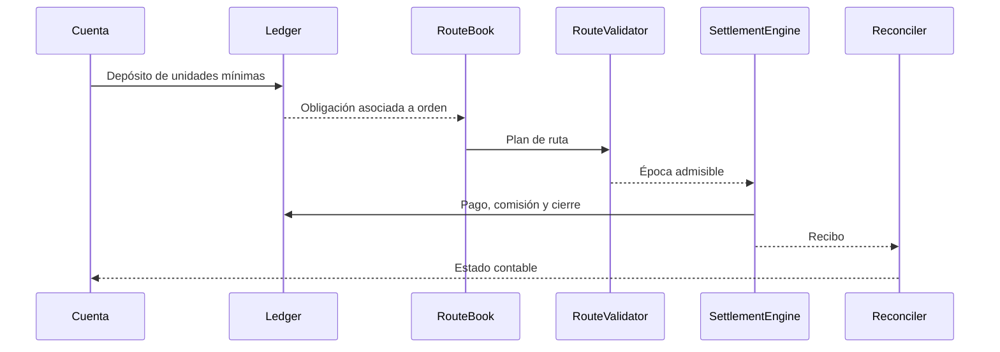

# Arquitectura y ciclo de vida

`Registry` mantiene parámetros y permisos; `Ledger`, cuentas, caja y obligaciones; `RouteBook`, órdenes y planes. `SettlementEngine` obtiene instrucciones de `PlanReducer` y emite recibos por época. `Reconciler` calcula los agregados posteriores. `ScenarioBuilder` genera cuatro conjuntos reproducibles en memoria, sin conexiones persistentes.

La orden avanza `Draft → Deposited → Routed → Settled`. Los eventos recogen altas, depósitos, reducción, ejecución y reconciliación. El CLI adapta el estado a texto o JSON.

| Módulo       | Responsabilidad                                   | Salida               |
| ------------ | ------------------------------------------------- | -------------------- |
| `registry`   | Activos, dominios, operadores, ventanas y bóvedas | Parámetros           |
| `ledger`     | Balances, pasivos, pagos y comisiones             | Saldos               |
| `route`      | Órdenes, tramos y validación                      | Plan admisible       |
| `reducer`    | Agrupación operativa                              | Instrucciones        |
| `settlement` | Aplicación por época                              | Recibos              |
| `reconcile`  | Agregados de conservación                         | Informe              |
| `treasury`   | Cobertura y concentración                         | JSON de solo lectura |
