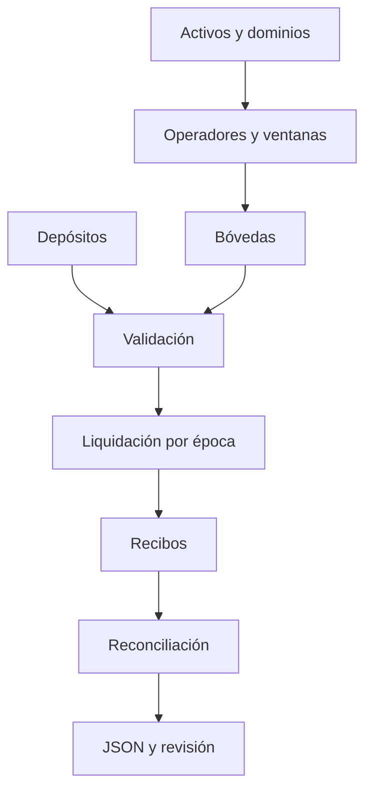

# Controles de seguridad

`ScenarioBuilder` introduce datos en registro, ledger y rutas. `RouteValidator` valida tramos y épocas; `SettlementEngine` ejecuta instrucciones; `Reconciler` observa el resultado. La salida JSON es un límite de integración, no una autorización de pagos.

Los controles incluyen compatibilidad de activo/dominio, autorización del operador, ventana abierta, importes positivos, tarifa en puntos básicos y prevención de doble liquidación en un mismo motor. La reconciliación compara saldos, pasivos y pagos. La vista de tesorería ofrece cobertura por bóveda y concentración por activo, pero no modifica el estado. Un agregado correcto no demuestra que cada evento individual sea correcto; se revisan órdenes, instrucciones y recibos.

Cambios en `route`, `reducer`, `settlement` o `ledger` requieren pruebas con varios activos, operadores, bóvedas y épocas. Cambios en JSON requieren verificar tipos, unidades y compatibilidad. CI, rama de producción, tag y release se verifican por separado y no equivalen a auditoría externa.
