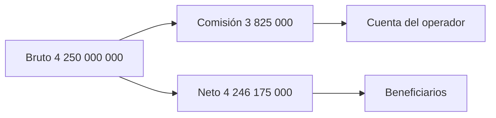

# Modelo económico

La unidad de cuenta depende de la precisión del activo. ZUSD usa seis decimales: `2 500 000 000` unidades mínimas equivalen a `2 500` ZUSD. Los activos distintos no deben agregarse sin valoración explícita.

En `balanced`, la primera orden deposita `2 500 000 000` unidades. Con 9 puntos básicos, su comisión es `2 250 000` y su neto `2 497 750 000`. La segunda orden de `1 750 000 000` produce comisión `1 575 000` y neto `1 748 425 000`. Bruto conjunto: `4 250 000 000`; comisión: `3 825 000`; neto: `4 246 175 000`.

El redondeo se aplica por tramo; la comisión agregada suma las comisiones individuales. `pendingLiability` mide obligaciones abiertas, `cash` la caja y `released` los pagos acumulados. La capacidad inmediatamente disponible es `max(cash − pendingLiability, 0)`. Para el seguimiento operativo se revisan recibos, saldos y estados por bóveda además de agregados.

`coverageBps` y `releaseShareBps` son indicadores posteriores de seguimiento. La primera razón devuelve cero cuando no hay pasivo; la segunda mide concentración de pagos por activo. Ninguna es una garantía de solvencia. Consulte `./out/tesseractdtl treasury mesh-reconcile --epoch 2`.
